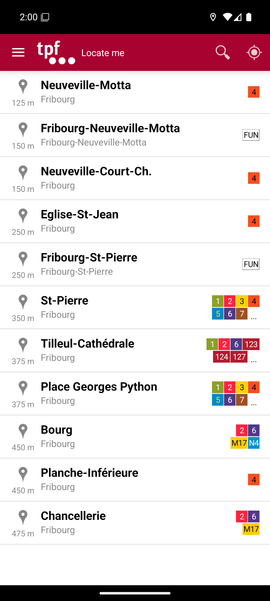
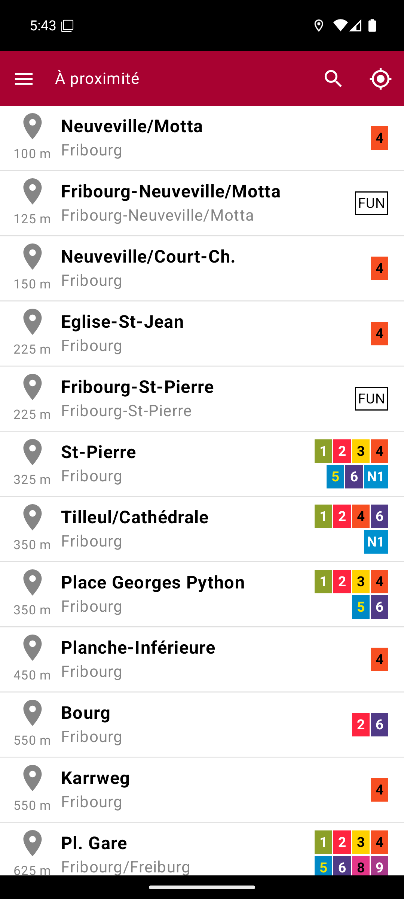
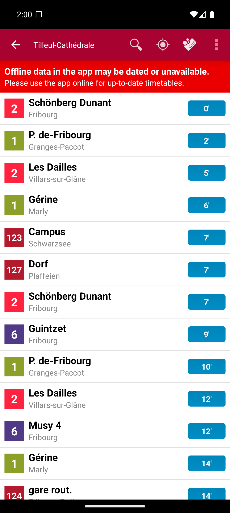
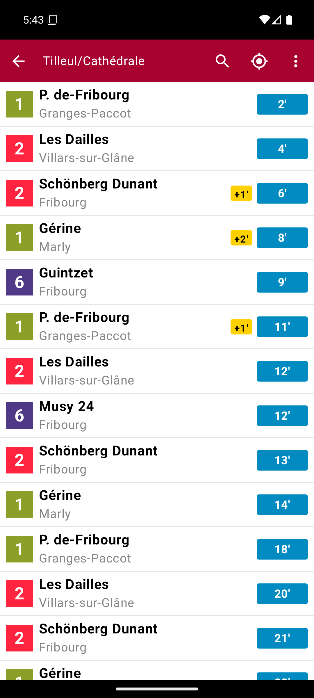
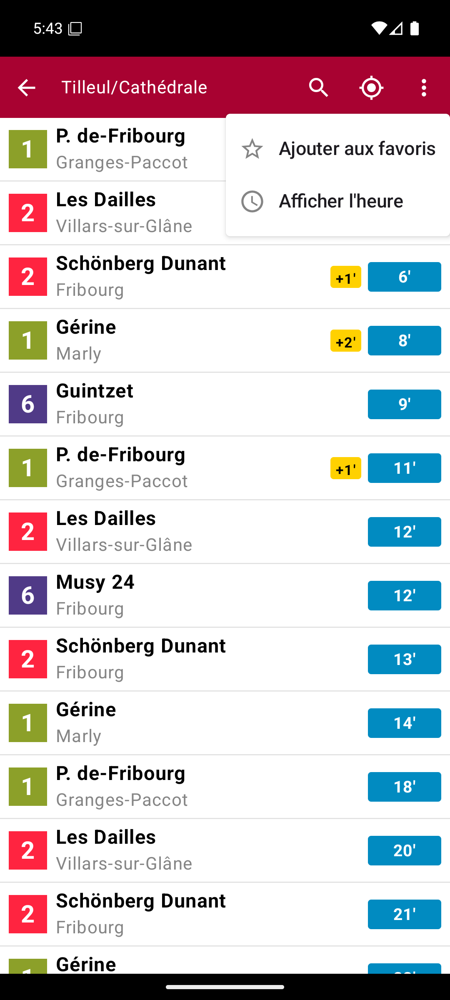
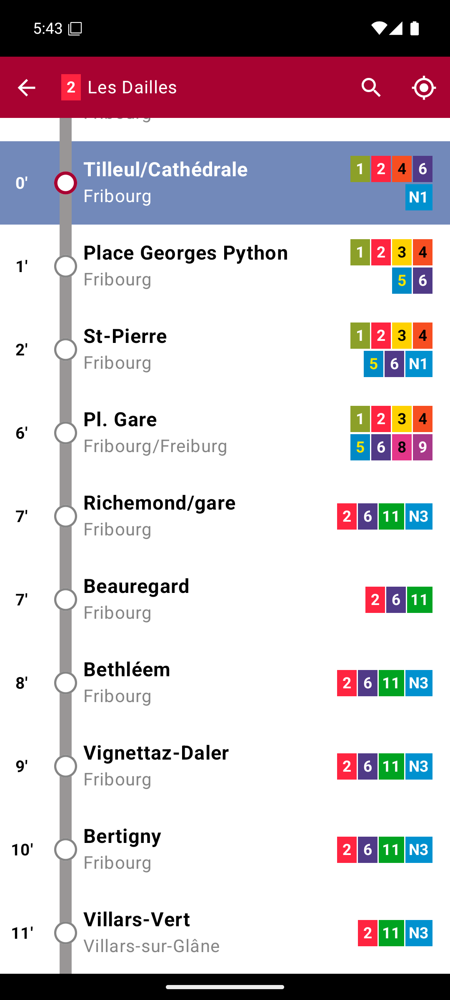
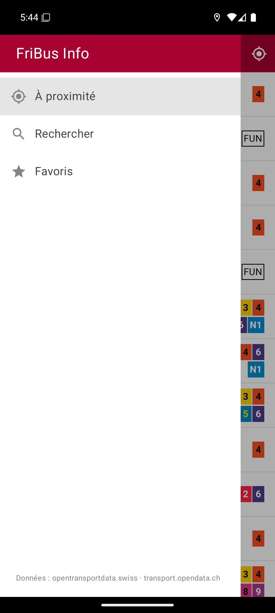

# Recette : comparaison avec l'ancienne app (TPF Info 2.9.10) — 2026-11-16

Méthode : AVD `mission_geo_phone` (1080×2400), position simulée 46.8032 / 7.1597, arrêt Tilleul-Cathédrale (ancienne app) / Tilleul/Cathédrale (FriBus Info).
Ancienne app capturée avec l'horloge en juin 2021 (seule date acceptée par son horaire embarqué) ; FriBus Info v1.0.0 (APK de la release) capturée à la date réelle, réseau actif.
Les écarts sont étiquetés « voulu » avec la référence à la spec (`docs/superpowers/specs/2026-11-16-fribus-info-design.md`) ou à une décision du contrôleur ; sinon « non voulu ».

## 1. À proximité

| Ancienne app | FriBus Info |
|---|---|
|  |  |

| Élément | Ancienne app | FriBus Info | Statut |
|---|---|---|---|
| Barre de titre | Logo « tpf » + « Locate me » | Texte « À proximité » | voulu — spec §4, §6 |
| Noms d'arrêts | « Neuveville-Motta », « Tilleul-Cathédrale » | « Neuveville/Motta », « Tilleul/Cathédrale » | voulu — spec §8 |
| Distances, arrêts, lignes | 125 m, 150 m… ; lignes 7, 123, 124, 127, M17, N4… | 100 m, 125 m… ; lignes 1–6, 8, 9, 11, N1–N3… | voulu — spec §5, §8 |
| Pastilles de lignes, forme | Carrés d'environ 38×38 px, interligne 43 px | Rectangles d'environ 39×52 px, interligne 57 px (plus hautes) | **non voulu** |
| Pastilles de lignes, texte | Chiffres en graisse moyenne | Chiffres en gras | **non voulu** |
| Pastilles de lignes, trop-plein | « … » après 2 rangées de 4 | Jusqu'à 8 pastilles sur 2 rangées, sans « … » | à vérifier (contrôleur) |
| Icône menu | x≈60 | x≈53 | **non voulu**, mineur |
| Hauteur des lignes | 143 px | 145 px | négligeable |
| Défilement initial | Liste en haut | Au tout premier lancement après installation, la liste s'est affichée déjà défilée (Neuveville masqué) ; au lancement suivant, en haut | **non voulu** (constaté 1 fois) |

## 2. Départs de l'arrêt

| Ancienne app | FriBus Info |
|---|---|
|  |  |

| Élément | Ancienne app | FriBus Info | Statut |
|---|---|---|---|
| Icône billet (CHF) | Présente | Absente | voulu — spec §6.2 |
| Bandeau rouge « Offline data… » | Présent | Absent | voulu — spec §6.2 |
| Départs, destinations, minutes | Horaire 2021 | Horaire réel actuel | voulu — spec §8 |
| Retard | Pas de libellé | Étiquette jaune « +N' » à gauche de la pastille | voulu — spec §7 |
| Ordre des lignes | Horaire théorique | Heure réelle | voulu — spec §7 |
| Icônes de la barre | Loupe, localisation, billet, ⋮ | Loupe, localisation, ⋮ | voulu (billet absent) |
| Marge gauche de la barre | Flèche x≈61, titre x≈132 | Flèche x≈53, titre x≈123 | **non voulu**, mineur |
| Largeur des textes | « Schönberg Dunant » : 323 px | Même texte : 340 px (+5 %, police un peu plus grasse/large) | **non voulu**, mineur |
| Badge de ligne et pastille de temps | Carré 77 px, pastille bleue arrondie | Identiques | identique |
| Hauteur de ligne | 126 px | 127 px | négligeable |

## 3. Menu ⋮ des départs

| Ancienne app | FriBus Info |
|---|---|
|  |  |

| Élément | Ancienne app | FriBus Info | Statut |
|---|---|---|---|
| Libellés | « Add to favorites », « Switch to absolute time » | « Ajouter aux favoris », « Afficher l'heure » | voulu — spec §6 |
| Position du menu | Recouvre la barre de titre (ancré en haut à droite) | S'ouvre sous la barre | **non voulu** |
| Largeur du menu | 540 px, texte de 500 à 865 | 450 px, texte de 558 à 872 | **non voulu**, mineur |
| Icônes (étoile, horloge) | Étoile creuse, horloge | Identiques | identique |

## 4. Trajet de la première course de la ligne 2

| Ancienne app | FriBus Info |
|---|---|
|  |  |

| Élément | Ancienne app | FriBus Info | Statut |
|---|---|---|---|
| Icônes de la barre | Loupe, localisation, billet, ⋮ | Loupe, localisation | voulu — billet (spec §6.2), ⋮ absent (décision du contrôleur : aucune entrée dans le périmètre) |
| Titre | « 2 Schönberg Dunant » | « 2 Les Dailles » | voulu — spec §8 |
| Arrêts, minutes, correspondances | Réseau 2021 | Réseau actuel | voulu — spec §5, §8 |
| Défilement | Arrêt courant en haut | Arrêt courant en haut | identique |
| Ligne de temps (trait, cercles, arrêt courant, terminus) | Voir capture | Identique | identique |
| Pastilles de correspondance | Carrés 38×38 | Rectangles 39×52, gras | **non voulu** (voir écran 1) |

## 5. Recherche « gare »

| Ancienne app | FriBus Info |
|---|---|
|  |  |

| Élément | Ancienne app | FriBus Info | Statut |
|---|---|---|---|
| Champ vide | Titre tronqué « Se… » | Placeholder « Rechercher un arrêt » dans le champ + icône loupe | voulu — décision du contrôleur |
| Résultats | Arrêts TPF de toute la Suisse romande (Albeuve, Avenches…) | Arrêts du réseau actuel (Avry-Matran, Belfaux CFF, Givisiez…) | voulu — spec §8 |
| Lignes affichées | Anciennes lignes (201, 290, N14…) | Lignes conservées uniquement | voulu — spec §5 |
| Marge gauche de la liste | Textes à x≈36 | Textes à x≈45 | **non voulu**, mineur |
| Bouton effacer ✕ | x≈761 | x≈848 (bord droit) | **non voulu**, mineur |

## 6. Tiroir de navigation

| Ancienne app | FriBus Info |
|---|---|
|  |  |

| Élément | Ancienne app | FriBus Info | Statut |
|---|---|---|---|
| Logo / nom | Logo « tpf » dans la barre | Titre « FriBus Info » | voulu — spec §4 |
| Entrées | Locate me, Stations, Recent, Favorites, Maps, Informations, Settings, About this App | À proximité, Rechercher, Favoris | voulu — spec §3, §6.5 |
| Source des données | Absente | « Données : opentransportdata.swiss · transport.opendata.ch » | voulu — spec §6.5, §9 |
| Largeur du tiroir | 525 px (58 % de l'écran), sous la barre | 787 px (87 % de l'écran), couvre la barre | **non voulu** |
| Haut du tiroir | Barre d'application conservée au-dessus | Tiroir par-dessus la barre (en-tête rouge avec titre) | **non voulu** (lié à la largeur/gabarit) |
| Icônes et libellés | Icône x≈100, libellé x≈190 | Icône x≈60, libellé x≈115 | **non voulu**, mineur |
| Marge haute de la liste | Première entrée collée à la barre | 17 px blancs avant la première entrée | **non voulu**, mineur |
| Hauteur des entrées, surlignage actif | 122 px, gris clair | Identiques | identique |

## Conclusion

Tous les écarts « voulu » sont conformes à la spec ou aux décisions du contrôleur. Écarts **non voulus** à décider :

1. Pastilles de lignes d'arrêt (écrans 1, 4) : rectangles 39×52 px au lieu de carrés 38×38, interligne 57 px au lieu de 43, chiffres en gras au lieu de graisse moyenne.
2. Tiroir (écran 6) : 787 px de large au lieu de 525 px et recouvre la barre ; icônes/libellés décalés (x≈60/115 au lieu de 100/190) ; 17 px blancs en haut.
3. Menu ⋮ (écran 3) : s'ouvre sous la barre au lieu de la recouvrir ; 450 px de large au lieu de 540 px.
4. Liste « À proximité » (écran 1) : au tout premier lancement après installation, la liste s'est affichée défilée vers le bas (constaté une fois).
5. Mineurs : marges de la barre (flèche 53 px au lieu de 61, titre 123 au lieu de 132), noms d'arrêts environ 5 % plus larges/gras, marge gauche de la recherche (45 px au lieu de 36), ✕ au bord droit (848 au lieu de 761).
6. À vérifier : trop-plein des pastilles (« … » après 6 dans l'ancienne app, jusqu'à 8 sans « … » dans FriBus Info).

Mesures prises sur les captures 1080×2400 vues à 900 px de large (échelle 1,2).
