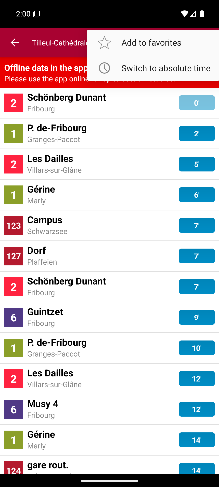
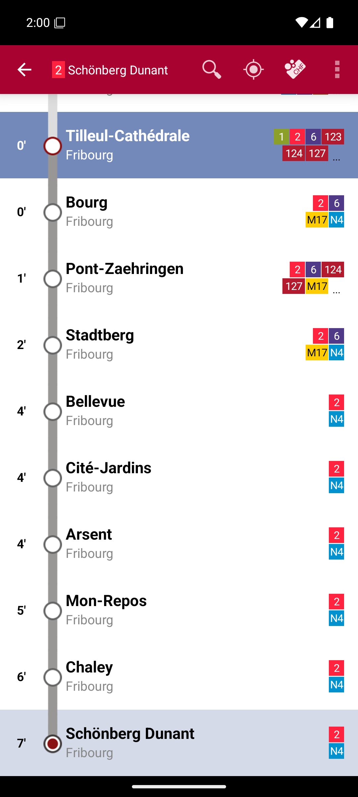
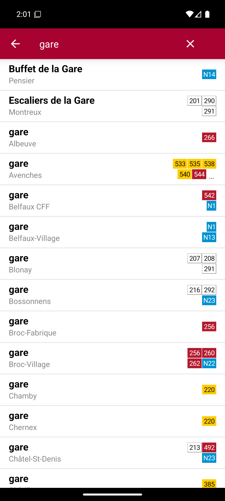
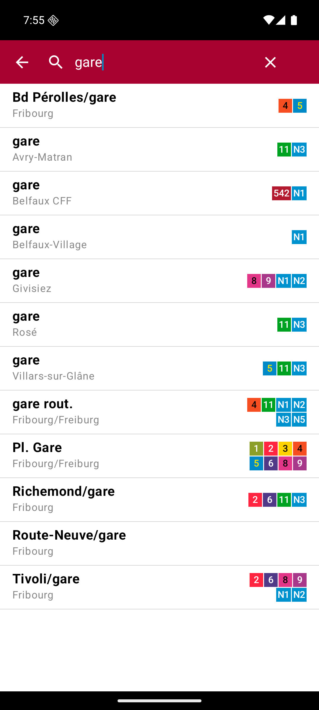
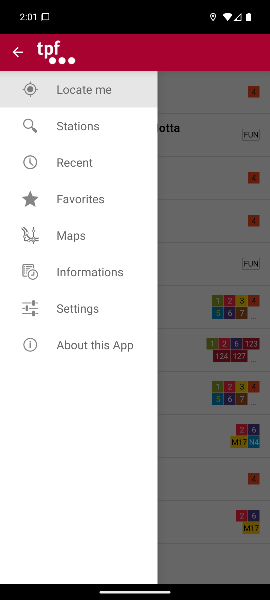

# Recette : comparaison avec l'ancienne app (TPF Info 2.9.10) — 2026-11-16

Méthode : AVD `mission_geo_phone` (1080×2400), position simulée 46.8032 / 7.1597, arrêt Tilleul-Cathédrale (ancienne app) / Tilleul/Cathédrale (FriBus Info).
Ancienne app capturée avec l'horloge en juin 2021 (seule date acceptée par son horaire embarqué) ; FriBus Info v1.0.0 (APK de la release) capturée à la date réelle, réseau actif.
Les écarts sont étiquetés « voulu » avec la référence à la spec (`docs/superpowers/specs/2026-11-16-fribus-info-design.md`) ou à une décision du contrôleur ; sinon « non voulu ».

## 1. À proximité

| Ancienne app | FriBus Info |
|---|---|
|  |  |

| Élément | Ancienne app | FriBus Info | Statut |
|---|---|---|---|
| Barre de titre | Logo « tpf » + « Locate me » | Texte « À proximité » | voulu — spec §4, §6 |
| Noms d'arrêts | « Neuveville-Motta », « Tilleul-Cathédrale » | « Neuveville/Motta », « Tilleul/Cathédrale » | voulu — spec §8 |
| Distances, arrêts, lignes | 125 m, 150 m… ; lignes 7, 123, 124, 127, M17, N4… | 100 m, 125 m… ; lignes 1–6, 8, 9, 11, N1–N3… | voulu — spec §5, §8 |
| Pastilles de lignes, forme | Carrés 46×47 px réels (17,5 dp), pas 48 px, interligne 52 px | Carrés 46×47 px, mêmes pas et interligne ; plus larges seulement pour « 542 », « FUN », « N1 » | corrigé (commit 02292fb) |
| Pastilles de lignes, texte | Chiffres en graisse moyenne, hauteur 23 px | Graisse moyenne, 12 sp | corrigé (commit 02292fb) |
| Pastilles de lignes, trop-plein | « … » après 2 rangées de 4 | Jusqu'à 8 pastilles sur 2 rangées, sans « … » | à vérifier (contrôleur) |
| Icône menu | x≈60 | x≈61 (+4 dp de marge) | corrigé (commit 02292fb) |
| Textes des lignes d'arrêt | Nom 306 px (« Eglise-St-Jean »), commune 131 px, distance 85 px | 305 / 136 / 87 px (17 / 13,5 / 12 sp), mêmes positions verticales à ±2 px | corrigé (commit 02292fb) |
| Pictogramme repère et icônes de la barre (loupe, localisation) | Dessins propres à l'ancienne app (repère étroit, loupe plus grande) | Icônes Material de tailles ajustées (même emprise) ; dessin légèrement différent | voulu — icônes standard (pas d'actifs de l'ancienne app) |
| Hauteur des lignes | 172 px (distance) / 151 px (sans distance : recherche, favoris) | 172 / 151 px | corrigé |
| Défilement initial | Liste en haut | La liste revient en haut dès qu'une nouvelle position donne une liste différente (pas au rafraîchissement identique) ; vérifié à l'installation neuve : en haut | corrigé (commit 02292fb) (test `NearbyScrollTest`) |

## 2. Départs de l'arrêt

| Ancienne app | FriBus Info |
|---|---|
|  |  |

| Élément | Ancienne app | FriBus Info | Statut |
|---|---|---|---|
| Icône billet (CHF) | Présente | Absente | voulu — spec §6.2 |
| Bandeau rouge « Offline data… » | Présent | Absent | voulu — spec §6.2 |
| Départs, destinations, minutes | Horaire 2021 | Horaire réel actuel | voulu — spec §8 |
| Retard | Pas de libellé | Étiquette jaune « +N' » à gauche de la pastille | voulu — spec §7 |
| Ordre des lignes | Horaire théorique | Heure réelle | voulu — spec §7 |
| Icônes de la barre | Loupe, localisation, billet, ⋮ | Loupe, localisation, ⋮ | voulu (billet absent) |
| Marge gauche de la barre | Flèche x≈61, titre x≈132 | Flèche x≈62, titre x≈132 | corrigé (commit 02292fb) |
| Largeur des textes | « Schönberg Dunant » : 323 px | 323 px (17 sp ; commune 13,5 sp) | corrigé (commit 02292fb) |
| Badge de ligne et pastille de temps | Carré 77 px, pastille bleue arrondie | Identiques | identique |
| Hauteur de ligne | 126 px | 127 px | négligeable |

## 3. Menu ⋮ des départs

| Ancienne app | FriBus Info |
|---|---|
|  |  |

| Élément | Ancienne app | FriBus Info | Statut |
|---|---|---|---|
| Libellés | « Add to favorites », « Switch to absolute time » | « Ajouter aux favoris », « Afficher l'heure » | voulu — spec §6 |
| Position du menu | Recouvre la barre de titre (ancré en haut à droite) | Recouvre la barre, bord droit à l'écran, haut à y=146 px (comme l'ancienne) | corrigé (commit 02292fb) |
| Largeur et gabarit du menu | 649 px réels (247 dp), sans marge verticale, icône x≈430, texte x≈500 | Identique (icône 432, texte 502) | corrigé (commit 02292fb) |
| Icônes (étoile, horloge) | Étoile creuse, horloge | Identiques | identique |

## 4. Trajet de la première course de la ligne 2

| Ancienne app | FriBus Info |
|---|---|
|  |  |

| Élément | Ancienne app | FriBus Info | Statut |
|---|---|---|---|
| Icônes de la barre | Loupe, localisation, billet, ⋮ | Loupe, localisation | voulu — billet (spec §6.2), ⋮ absent (décision du contrôleur : aucune entrée dans le périmètre) |
| Titre | « 2 Schönberg Dunant » | « 2 Les Dailles » | voulu — spec §8 |
| Arrêts, minutes, correspondances | Réseau 2021 | Réseau actuel | voulu — spec §5, §8 |
| Défilement | Arrêt courant en haut | Arrêt courant en haut | identique |
| Ligne de temps (trait, cercles, arrêt courant, terminus) | Voir capture | Identique | identique |
| Pastilles de correspondance | Carrés 46×47 px | Identiques | corrigé (commit 02292fb) (voir écran 1) |
| Badge du titre (« 2 ») | 39×51 px, chiffre 13,5 sp | Identique | corrigé (commit 02292fb) |

## 5. Recherche « gare »

| Ancienne app | FriBus Info |
|---|---|
|  |  |

| Élément | Ancienne app | FriBus Info | Statut |
|---|---|---|---|
| Champ vide | Titre tronqué « Se… » | Placeholder « Rechercher un arrêt » dans le champ + icône loupe | voulu — décision du contrôleur |
| Résultats | Arrêts TPF de toute la Suisse romande (Albeuve, Avenches…) | Arrêts du réseau actuel (Avry-Matran, Belfaux CFF, Givisiez…) | voulu — spec §8 |
| Lignes affichées | Anciennes lignes (201, 290, N14…) | Lignes conservées uniquement | voulu — spec §5 |
| Marge gauche de la liste | Textes à x≈36 | x≈36 | corrigé (commit 02292fb) |
| Bouton effacer ✕ | x≈761 | x≈763 | corrigé (commit 02292fb) |

## 6. Tiroir de navigation

| Ancienne app | FriBus Info |
|---|---|
|  |  |

| Élément | Ancienne app | FriBus Info | Statut |
|---|---|---|---|
| Logo / nom | Logo « tpf » dans la barre | Titre « FriBus Info » | voulu — spec §4 |
| Entrées | Locate me, Stations, Recent, Favorites, Maps, Informations, Settings, About this App | À proximité, Rechercher, Favoris | voulu — spec §3, §6.5 |
| Source des données | Absente | « Données : opentransportdata.swiss · transport.opendata.ch » | voulu — spec §6.5, §9 |
| Largeur du tiroir | 630 px réels (240 dp), sous la barre, voile noir à 60 % | 630 px, sous la barre, voile 60 % | corrigé (commit 02292fb) |
| Haut du tiroir | Barre conservée au-dessus, flèche retour, logo seul (ni titre ni actions) | Barre conservée, flèche retour (ferme le tiroir), titre à la place du logo, actions masquées ; pas d'en-tête | corrigé (commit 02292fb) |
| Icônes et libellés | Icône x≈100, libellé x≈190 | Icône x≈100, libellé x≈189 | corrigé (commit 02292fb) |
| Dessin des icônes du tiroir | Icônes propres à l'ancienne app | Icônes Material équivalentes | voulu — icônes standard |
| Marge haute de la liste | Première entrée collée à la barre | Collée à la barre | corrigé (commit 02292fb) |
| Hauteur des entrées, surlignage actif | 122 px, gris clair | Identiques | identique |

## Conclusion

Tous les écarts « voulu » sont conformes à la spec ou aux décisions du contrôleur. Les écarts « non voulu » listés dans la première version (pastilles, textes, tiroir, menu ⋮, défilement initial, marges de barre, recherche) sont **corrigés** (commit 02292fb) et recapturés (`*-fribus.png`) ; mesures à ±2 px sur les captures 1080×2400.

Ce qui reste, sans être corrigeable par réglage :

1. Pastilles de trop-plein (« … » après 6 dans l'ancienne app, jusqu'à 8 sans « … » dans FriBus Info) : **à vérifier (contrôleur)**, non modifié (comportement défini par la spec).
2. Dessin des icônes (repère de distance, loupe, localisation, icônes du tiroir et du menu ⋮) : icônes Material à la même emprise que les originales, pas leur dessin exact (actifs de l'ancienne app non repris).
3. Hauteur de glyphes de la commune (13,5 sp) : l'ancienne police est un peu plus haute à largeur égale (≈ 3 px) ; invisible à l'usage.
4. Barre du tiroir ouvert : le titre de l'écran remplace le logo « tpf » (voulu, spec §4).

Aucun autre écart non souhaité constaté. Mesures prises sur les captures 1080×2400 (densité 2,625 px/dp).
